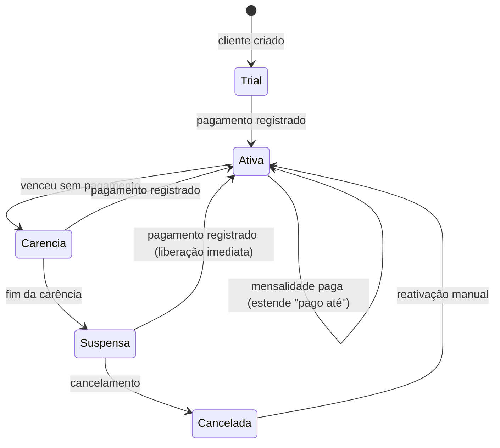
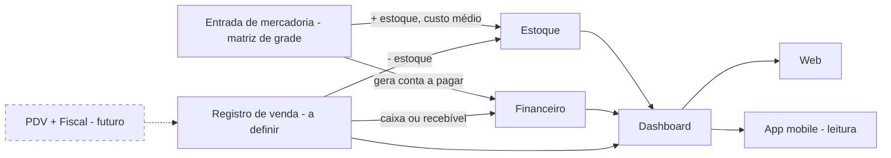

# KamusERP — Levantamento do Projeto

> Documento vivo. Vamos atualizando a cada conversa. Seções marcadas com **[ABERTO]** ainda precisam de decisão.

**Última atualização:** 2026-10-13

---

## 1. Visão geral

SaaS no estilo ERP voltado para varejo de pequeno e médio porte. **Piloto: lojas de roupas.**

Escopo do piloto:

- **Controle de estoque** com grade (tamanho × cor)
- **Controle financeiro**
- **Web** (operação completa) + **Mobile** (somente leitura, para o dono acompanhar a empresa em tempo real)

Fora do escopo do piloto (em estudo):

- **PDV** e **emissão fiscal** (NFC-e/NF-e) — o fiscal é o maior risco do projeto; será estudado à parte antes de entrar no roadmap (ver 4.4 e 4.5).
- **Lote e validade** — não se aplica a loja de roupas.

Por ser SaaS, **multi-tenant** desde o primeiro dia: várias empresas (clientes) usando a mesma instalação, com dados isolados.

---

## 2. Stack

| Camada | Escolha | Observações |
|---|---|---|
| Backend | .NET (ASP.NET Core Web API, versão LTS mais recente) | Monólito modular (ver seção 3) |
| Banco | PostgreSQL | EF Core + Npgsql; migrations versionadas |
| Frontend web | React + TypeScript + Tailwind | Vite como bundler |
| Mobile | React Native (Expo) + TypeScript | Somente leitura no início |
| Infra local | Docker Compose | api, db, web, (pgAdmin opcional) |
| Hospedagem | VPS (Hetzner/DigitalOcean/AWS Lightsail ou EC2) | Imagens Docker publicadas no GHCR |
| CI/CD | GitHub Actions | Build + testes obrigatórios em todo PR |
| Metodologia | **TDD first** | Teste antes do código, sempre |

**Decidido:**
- Autenticação: **ASP.NET Core Identity + JWT com refresh token** (sem provedor externo por enquanto).
- **Monorepo** — backend, web e mobile neste repositório (ver seção 10).

---

## 3. Arquitetura

### 3.1 Monólito modular

Começar com **um único deploy** do backend, mas dividido em módulos com fronteiras claras (Estoque, Financeiro, Vendas/PDV, Cadastros, Identidade). Cada módulo tem seu próprio domínio, aplicação e persistência. Se um dia precisar virar microserviço, a fronteira já existe. Microserviços agora seriam custo sem benefício.

Dentro de cada módulo, camadas no estilo Clean Architecture:

```
Modulo.Domain          -> entidades, value objects, regras de negócio (sem dependências)
Modulo.Application     -> casos de uso (commands/queries), interfaces
Modulo.Infrastructure  -> EF Core, integrações externas
Api                    -> endpoints, auth, composição
```

Comunicação entre módulos: via **eventos de domínio** (ex.: `VendaFinalizada` → Estoque baixa saldo, Financeiro gera recebível). No início, eventos em memória; depois, se necessário, outbox + fila.

### 3.2 Multi-tenancy

| Estratégia | Prós | Contras |
|---|---|---|
| **Banco compartilhado + coluna `tenant_id`** | Simples, barato, uma migration só | Risco de vazamento se esquecer o filtro |
| Schema por tenant | Isolamento melhor | Migrations N vezes, mais complexo |
| Banco por tenant | Isolamento máximo | Caro e trabalhoso para SaaS pequeno |

**Sugestão:** banco compartilhado com `tenant_id` em todas as tabelas de negócio, protegido em duas camadas:
1. **Global Query Filter** do EF Core (filtro automático por tenant).
2. **Row Level Security (RLS)** do PostgreSQL como rede de segurança.

E um teste automatizado que garante que nenhuma entidade de negócio existe sem `tenant_id`.

### 3.3 Hierarquia

```
Tenant (cliente do SaaS / assinatura)
 └── Empresa (CNPJ)
      └── Loja/Filial (estoque e caixa são por loja)
           └── Usuários com perfis (Dono, Gerente, Operador de caixa, Estoquista, Financeiro)
```

**Decidido:** um tenant pode ter **mais de um CNPJ** (ex.: dono com duas lojas em CNPJs diferentes). Já modelar assim desde o início.

---

## 4. Módulos e regras de negócio

### 4.1 Cadastros base

- **Produtos:** código interno, código de barras (EAN/GTIN), descrição, unidade, preço de venda, preço de custo, categoria, marca, dados fiscais (NCM, CEST, origem), ativo/inativo.
- **Variações (grade) — obrigatório no piloto:** ver 4.1.1.
- **Unidades e conversão:** compra em CX com 12, vende em UN.
- **Clientes e fornecedores:** pessoa física/jurídica, CPF/CNPJ, contatos, endereço. Normalmente uma única entidade "Pessoa" com papéis.
- **Usuários e permissões:** perfis + permissões granulares (ex.: "dar desconto acima de 10%", "cancelar venda").

#### 4.1.1 Grade de produtos (loja de roupas)

É o coração do cadastro em loja de roupas. Modelo:

```
Produto (modelo)         -> "Camiseta Básica Gola V" — descrição, marca, categoria, coleção, preço base, NCM futuro
 └── SKU (variação)      -> Camiseta Básica Gola V / Azul / M — código de barras próprio, estoque próprio
```

- **Atributos de grade:** começar com **Tamanho** e **Cor** (dois eixos). Modelar de forma genérica (atributo + valores) para permitir um terceiro eixo no futuro (ex.: comprimento/numeração de calça 38–48).
- **Grades de tamanho reutilizáveis:** cadastrar "grades" padrão — *PP–GG*, *36–48* (calça), *1–16* (infantil), *Único* — e aplicar ao produto. A grade define também a **ordem de exibição** (P antes de M, não alfabético).
- **Geração automática de SKUs:** ao criar o produto, escolher grade de tamanhos + cores → sistema gera todas as combinações; o usuário pode desativar combinações que não existem.
- **Código de barras por SKU:** EAN do fornecedor quando houver; senão, **código interno gerado** pelo sistema (ex.: EAN-13 com prefixo "2", reservado para uso interno).
- **Preço:** definido no produto; **opcionalmente sobrescrito por SKU** (ex.: tamanhos plus mais caros).
- **Precificação por markup:** preço de venda sugerido = custo × markup (ex.: 2,0 a 2,5 é comum em moda). Markup padrão por categoria.
- **Coleção / estação:** ex.: "Verão 2027". Permite relatórios de giro por coleção e decisão de liquidação.
- **Referência do fornecedor:** guardar o código do fornecedor para facilitar a recompra.
- **Fotos:** foto por produto e, opcionalmente, por cor.
- **Impressão de etiquetas:** etiqueta com código de barras, tamanho, cor e preço — gerada na entrada de mercadoria (quantidade = quantidade recebida por SKU). Etiquetas são essenciais para o futuro PDV.

**Visualização em matriz:** o estoque de um produto deve ser exibido como tabela **cor × tamanho**, que é como o lojista pensa:

| Cor \ Tam. | P | M | G | GG |
|---|---|---|---|---|
| Azul | 3 | 5 | 2 | 0 |
| Preto | 4 | 6 | 4 | 1 |

A entrada de mercadoria também deve permitir digitar quantidades nessa matriz.

### 4.2 Estoque

**Princípio central:** o saldo **não é um campo que se edita**. O saldo é a soma de **movimentações** imutáveis (um livro-razão). Isso dá rastreabilidade total ("por que o saldo está 7?").

**Tipos de movimentação:**

| Tipo | Origem típica | Efeito |
|---|---|---|
| Entrada por compra | Lançamento manual na matriz de grade (MVP); importação do XML da NF-e do fornecedor (futuro) | + saldo, recalcula custo |
| Saída por venda | Registro de venda (ver 4.4 e pergunta 1 da seção 12) | − saldo |
| Devolução de cliente | Troca/devolução | + saldo |
| Devolução a fornecedor | Avaria/erro | − saldo |
| Ajuste | Perda, quebra, furto, vencimento (com motivo obrigatório) | ± saldo |
| Transferência | Loja A → Loja B | − em A, + em B |
| Inventário | Contagem física | Gera ajuste pela diferença |

**Regras importantes:**
- **Custo médio ponderado:** é o método mais usado no Brasil (e aceito pelo fisco). A cada entrada: `novo_custo = (saldo_atual × custo_atual + qtd_entrada × custo_entrada) / (saldo_atual + qtd_entrada)`. Base do lucro bruto e do CMV.
- **Estoque mínimo / ponto de reposição:** alerta quando o saldo cai abaixo do limite.
- **Estoque negativo:** **configurável por empresa**; padrão = permitir com alerta (não travar a venda por erro de cadastro/contagem).
- **Reserva:** pedido aprovado reserva quantidade (saldo disponível = físico − reservado). Pode ficar para depois do MVP.
- **Inventário:** congela uma "foto" do saldo, contagem (pode ser por coletor/celular), comparação, aprovação, ajuste.

**Relatórios:** posição de estoque (em matriz cor × tamanho), kardex (extrato por SKU), curva ABC, produtos parados, valor total em estoque, **giro por coleção**, **quebra de grade** (produto que acabou em tamanhos-chave como M e G, mas ainda tem P e GG — sinal de reposição ou liquidação).

### 4.3 Financeiro

**Conceito central:** **títulos** (contas a pagar e a receber) com **parcelas**, e **baixas** (pagamentos/recebimentos, podendo ser parciais).

- **Contas a receber:** geradas por vendas a prazo, cartão (o dinheiro cai depois), boleto, crediário.
- **Contas a pagar:** fornecedores (geradas da entrada de nota), despesas fixas (aluguel, luz), impostos, folha.
- **Contas financeiras:** caixa da loja, conta bancária, carteira digital. Toda baixa movimenta uma conta financeira.
- **Plano de contas:** categorização hierárquica (Receitas > Vendas; Despesas > Ocupação > Aluguel). Base do DRE.
- **Centro de custo:** opcional (ex.: por loja).
- **Juros, multa e desconto** na baixa.
- **Recorrência:** despesas fixas geradas automaticamente todo mês.
- **Conciliação bancária:** importar extrato (OFX) e casar com os lançamentos. Pós-MVP.

**Regime de caixa × competência** (precisa entender bem):
- **Caixa:** conta quando o dinheiro entra/sai → base do **Fluxo de Caixa**.
- **Competência:** conta quando o fato acontece (venda feita hoje, mesmo recebendo em 30 dias) → base do **DRE**.
- O sistema precisa guardar **as duas datas** (data de competência e data de vencimento/pagamento).

**Cartão de crédito/débito (detalhe que pega muita gente):**
- Venda de R$ 100 no crédito 3x não é R$ 100 no caixa hoje: é um recebível de 3 parcelas, **menos a taxa (MDR)** da maquininha, com prazo (ex.: D+30, D+60, D+90) — ou antecipado com outra taxa.
- Cadastro de **formas de pagamento** com taxa e prazo por bandeira/parcelas, para projetar o fluxo de caixa corretamente.
- PIX e dinheiro: entram na hora (PIX pode ter taxa dependendo do banco).

**Relatórios:** fluxo de caixa (previsto × realizado), DRE simplificado, contas vencidas/a vencer, inadimplência.

### 4.4 PDV (Ponto de Venda) — ⏸️ FORA DO PILOTO (em estudo)

> Decisão de 2026-10-13: PDV fica à parte até o estudo do fiscal ser concluído. O conteúdo abaixo é **material de referência** para esse estudo.
>
> Particularidades de loja de roupas para quando o PDV voltar: **troca** é muito frequente (troca por outro tamanho/cor, vale-troca/crédito do cliente), **condicional** (cliente leva peças para provar em casa e devolve o que não quiser) e **vendedor/comissão** por venda.

Fluxo de um dia típico de caixa:

1. **Abertura de caixa:** operador informa o **fundo de troco** (valor inicial em dinheiro).
2. **Venda:**
   - Adicionar itens (leitor de código de barras, busca por nome, quantidade, balança para itens pesados).
   - Identificar cliente (opcional — CPF na nota).
   - Descontos por item ou no total (limite por perfil; acima disso pede senha do gerente).
   - **Cancelamento de item** (com permissão e registro de auditoria).
   - **Pagamento:** uma ou várias formas na mesma venda (ex.: R$ 50 no dinheiro + resto no cartão), cálculo de troco.
   - **Emissão do cupom fiscal (NFC-e)** — ver 4.5.
3. **Sangria:** retirada de dinheiro do caixa durante o dia (segurança).
4. **Suprimento:** reforço de troco.
5. **Fechamento de caixa:** operador conta e informa os valores por forma de pagamento. Idealmente **fechamento cego** (o operador não vê o valor esperado antes de informar). Sistema mostra a diferença (sobra/falta).
6. **Cancelamento de venda / devolução / troca:** com regras de prazo e permissão; cancelamento fiscal tem prazo legal curto após a emissão.

**Integrações do PDV:**
- **Pagamento:** TEF ou POS integrado (Stone, Cielo, Rede, PagSeguro, Mercado Pago...) e **PIX com QR Code dinâmico** (confirmação automática).
- **Hardware:** leitor de código de barras (age como teclado — fácil), impressora térmica de cupom, balança, gaveta.

**Ao finalizar uma venda, o sistema deve (efeitos colaterais):**
- Baixar o estoque (movimentação de saída).
- Lançar no caixa (dinheiro/PIX) ou gerar recebível (cartão/crediário).
- Emitir o documento fiscal.

**[ABERTO] Ponto crítico — PDV offline:** loja não pode parar de vender se a internet cair. Opções:
- **A)** PDV 100% web (online obrigatório) — mais simples, mas arriscado.
- **B)** PDV web com fila local (IndexedDB/Service Worker) e sincronização posterior + NFC-e em contingência.
- **C)** PDV como app desktop (Electron/Tauri) com banco local.

Sugestão (quando o PDV entrar): começar com **A**, já desenhando os comandos de venda para serem **idempotentes** (ID gerado no cliente), o que facilita evoluir para **B**.

### 4.5 Fiscal (Brasil) — ⏸️ FORA DO PILOTO (em estudo, maior risco do projeto)

É a parte mais complexa e a que mais muda. Itens envolvidos:
- **NFC-e** (cupom fiscal eletrônico, venda ao consumidor no PDV) e **NF-e** (venda para empresa, entrada de mercadoria).
- Dados fiscais por produto: **NCM, CEST, CFOP, CST/CSOSN**, alíquotas.
- **Regime tributário** da empresa: Simples Nacional, Lucro Presumido, Lucro Real.
- **Certificado digital A1** da empresa.
- **Contingência** quando a SEFAZ está fora.
- **Reforma tributária (IBS/CBS):** transição começando em 2026 e indo até 2033. O sistema precisa nascer preparado para conviver com os dois modelos.

**Sugestão forte:** **não implementar a comunicação com a SEFAZ do zero.** Usar uma API fiscal terceirizada (ex.: Focus NFe, PlugNotas, NFE.io, Nuvem Fiscal) atrás de uma interface própria (`IEmissorFiscal`), para poder trocar de fornecedor. Validar regras tributárias com um contador.

**Decidido:** fiscal **não** entra no piloto. Quando entrar, será via API terceirizada atrás de `IEmissorFiscal`.

**Preparação já no piloto (barato e evita retrabalho):** o cadastro de produto já reserva campos fiscais opcionais (NCM, origem, CEST) e a empresa já guarda o regime tributário — sem nenhuma regra fiscal implementada.

**Roteiro de estudo sugerido:**
1. Conversar com um contador que atenda lojas de roupas (regime típico: Simples Nacional).
2. Entender NFC-e × NF-e e quando cada uma é exigida no estado do piloto.
3. Avaliar 2–3 APIs fiscais (preço por nota, ambiente de homologação, SDK/REST, suporte à reforma tributária).
4. Fazer uma **prova de conceito isolada** emitindo NFC-e em homologação, fora do código principal.

### 4.6 Dashboard / Mobile (somente leitura)

O que o dono quer ver no celular:
- **Vendas do dia** (total, quantidade, ticket médio) — comparação com ontem/semana passada.
- Vendas por loja, por vendedor, por forma de pagamento.
- **Estoque:** valor total, quebras de grade, mais vendidos por cor/tamanho.
- **Saldo financeiro** atual, contas a pagar/receber de hoje e da semana, vencidas.
- **Alertas:** estoque baixo, produtos sem giro, contas vencendo/vencidas.
- Produtos mais vendidos.

**Técnico:**
- Endpoints de leitura dedicados (`GET`), com **read models** otimizados (consultas agregadas / views materializadas), separados do modelo de escrita (CQRS leve).
- **"Tempo real":** começar com refresh ao abrir/puxar a tela + polling curto; evoluir para **SignalR** (WebSocket) se fizer diferença.
- **Push notifications** (Expo Notifications) para alertas importantes.
- Mesmo backend e mesma autenticação da web; perfil "Dono" com acesso de leitura a tudo.

---

## 5. Fundação da aplicação (dia 1)

Itens transversais que existem **antes** de qualquer módulo de negócio. Todos entram na Fase 0 do roadmap e seguem TDD como o resto.

> 🎨 **Mockups visuais** de todas as telas desta seção: [docs/mockups](docs/mockups/README.md).

### 5.1 Login e usuário de teste

- **Tela de login** (e-mail + senha) com ASP.NET Core Identity.
- **Tokens:** access token JWT de curta duração (~15 min) + **refresh token em cookie `HttpOnly`/`Secure`** com rotação. Nada de token em `localStorage`.
- **Segurança mínima desde o início:** senha com hash (padrão do Identity), bloqueio após N tentativas erradas, rate limit no endpoint de login, log de acesso (data, IP, sucesso/falha).
- **Usuário de teste via seed — somente em ambiente `Development`:**
  - Tenant "Loja Demo" com **2 CNPJs** (para testar o seletor de empresa), 1 loja em cada, produtos com grade, alguns títulos financeiros e notificações de exemplo.
  - Usuário: `admin@kamus.local`. A senha vem de variável de ambiente (`SEED_ADMIN_PASSWORD`), com valor padrão definido no `.env.example` — **nunca** senha real versionada no repositório.
  - O seed **não roda** em produção (verificação de ambiente + teste automatizado garantindo isso).
- **Um usuário pode acessar várias empresas** do mesmo tenant, com perfis possivelmente diferentes em cada uma.
- **Depois (não dia 1):** "esqueci minha senha" (exige envio de e-mail), 2FA para o perfil Dono.

### 5.2 Shell da aplicação (layout)

```
┌──────────────┬──────────────────────────────────────────────────────────────┐
│  KAMUS       │ [🔍 Pesquisar...  Ctrl+K]   [Empresa: Loja Centro ▾] [🔔 3] [☀/🌙] [👤] │
│              ├──────────────────────────────────────────────────────────────┤
│ ▣ Dashboard  │                                                              │
│ ▤ Cadastros ▸│                                                              │
│ ▥ Estoque   ▸│                    Conteúdo da página                         │
│ $ Financeiro▸│                                                              │
│ ▦ Relatórios │                                                              │
│ ⚙ Config.    │                                                              │
│              │                                                              │
│ [«] recolher │                                                              │
└──────────────┴──────────────────────────────────────────────────────────────┘
```

**Sidebar (esquerda):**
- Menu por módulo, com submenus; item ativo destacado.
- **Recolhível** (só ícones) — preferência salva por usuário.
- Itens **filtrados por permissão** (o usuário só vê o que pode acessar). O menu é definido em um único lugar (configuração), não espalhado pelo código.
- Em telas pequenas vira **drawer** (abre pelo botão ☰).

**Topbar:**
- **Pesquisa global** (ver 5.3).
- **Seletor de empresa/CNPJ** (ver 5.4).
- **Sininho de notificações** (ver 5.5).
- **Alternador de tema** (ver 5.7).
- **Menu do usuário:** perfil, preferências, sair.
- **Breadcrumb** abaixo da topbar (Estoque › Produtos › Camiseta Gola V).

**Componentes:** sugestão de usar **shadcn/ui** (componentes copiados para o projeto, baseados em Radix + Tailwind). Já traz sidebar, dropdown, command palette (cmdk), dialogs, tabelas e suporte nativo a dark mode — acelera muito o shell sem prender a uma biblioteca fechada.

### 5.3 Pesquisa global

- Atalho **Ctrl+K / ⌘K** abre uma "command palette".
- Pesquisa em uma só caixa: **produtos** (nome, referência, **código de barras/SKU**), **clientes**, **fornecedores**, **títulos financeiros** (número, valor) e também **telas/ações** ("nova entrada de mercadoria", "contas a pagar").
- Resultados agrupados por tipo, navegação por teclado, últimos itens acessados quando a busca está vazia.
- **Backend:** endpoint único `GET /api/search?q=` que consulta cada módulo (cada módulo expõe seu "provedor de busca"). PostgreSQL com extensões **`unaccent`** (ignora acentos) e **`pg_trgm`** (busca por trecho/erro de digitação), com índices.
- Respeita **tenant, empresa ativa e permissões** — nunca retorna o que o usuário não pode ver (teste automatizado para isso).

### 5.4 Seletor de empresa (troca de CNPJ)

- Dropdown na topbar com as empresas que o usuário tem acesso (nome fantasia + CNPJ formatado).
- **Empresa ativa** enviada em toda requisição (header `X-Empresa-Id`) e **validada no backend** contra os acessos do usuário — o frontend nunca é a fonte da verdade.
- Ao trocar: todos os dados em cache no frontend são descartados e a tela recarrega no contexto da nova empresa; a última empresa usada fica salva.
- Opção **"Todas as empresas" (visão consolidada)** para o perfil Dono — apenas em telas de leitura (dashboard, relatórios). Lançamentos sempre exigem uma empresa específica.
- Se o usuário tiver só uma empresa, o dropdown aparece apenas informativo.

### 5.5 Notificações (sininho)

- Badge com contador de não lidas; painel com lista, "marcar como lida" e "marcar todas".
- Clique leva ao item relacionado (ex.: produto com estoque baixo, título vencendo).
- **Tempo real via SignalR** (WebSocket) — o contador atualiza sem recarregar a página. Mesmo canal será reaproveitado pelo dashboard.
- **Modelo:** tabela `notificacoes` (tenant, empresa, usuário destinatário ou perfil, tipo, título, mensagem, link, lida_em, criada_em). Qualquer módulo cria notificações via um serviço comum.
- **Tipos iniciais:** estoque baixo / quebra de grade, contas a pagar vencendo hoje, contas vencidas, **exportação de relatório pronta** (5.6), **licença vencendo** (5.8).
- **Depois:** preferências por tipo (o que recebe e por qual canal), e-mail e push no mobile.

### 5.6 Exportação de relatórios (PDF e Excel)

**Princípio:** a tela e a exportação usam **a mesma consulta**. Um relatório é definido uma vez e renderizado em formatos diferentes.

```
Consulta do relatório  ->  ReportData (colunas, tipos, linhas, totais, filtros aplicados)
                                 ├── PdfExporter   (QuestPDF)
                                 ├── ExcelExporter (ClosedXML)
                                 └── CsvExporter   (de brinde)
```

- **Geração no backend** (não no navegador): dados grandes, formatação consistente e o mesmo resultado na web e no mobile.
- **Bibliotecas sugeridas:**
  - **QuestPDF** — PDF por código C#, ótimo para layout. *Licença Community gratuita para empresas com faturamento abaixo de US$ 1 milhão/ano; verificar ao crescer.*
  - **ClosedXML** — Excel (.xlsx), licença MIT.
- **Padrão visual de todo relatório:** cabeçalho com logo, razão social e CNPJ da empresa ativa, nome do relatório, **filtros aplicados**, data/hora de geração e usuário; rodapé com paginação; totais no fim.
- **Excel de verdade:** números como número (não texto), datas como data, moeda formatada em R$, cabeçalho congelado, filtro automático, largura de coluna ajustada.
- **PDF sempre no tema claro**, independente do tema da tela (é para imprimir).
- **Exportações grandes:** acima de um limite de linhas, a geração vai para **processamento em segundo plano**; quando termina, chega uma **notificação no sininho** com o link para baixar.
- **Componente padrão no frontend:** toda tabela/relatório tem o botão **"Exportar ▾ (PDF / Excel)"**, que envia os mesmos filtros da tela.
- **Testes:** o Excel gerado é relido com ClosedXML e o texto do PDF extraído (ex.: PdfPig) para verificar conteúdo e totais.
- Toda exportação fica **registrada em log** (quem exportou o quê) — relevante para LGPD.

### 5.7 Tema claro / escuro

- Três opções: **Claro**, **Escuro** e **Sistema** (segue o sistema operacional).
- **Tokens de cor em variáveis CSS** (`--background`, `--foreground`, `--primary`, `--muted`, `--border`, `--success`, `--danger`...) e Tailwind usando esses tokens. **Proibido usar cor "fixa"** (ex.: `bg-white`) nos componentes — tudo via token. Assim o dark mode funciona em qualquer tela nova sem esforço extra.
- Preferência salva **no perfil do usuário (backend)** e em `localStorage`; um script mínimo no `index.html` aplica o tema **antes** da página renderizar (evita o "piscar" branco).
- Gráficos do dashboard usam as mesmas variáveis de cor.
- **Mobile:** mesma ideia com `useColorScheme` do React Native e os mesmos tokens.
- **Teste:** testes E2E (Playwright) rodam as telas principais nos dois temas, com verificação de contraste (axe).

### 5.8 Licenciamento e mensalidade

**Ideia central:** como é SaaS (todos os clientes rodam no nosso servidor), a licença é um **estado guardado no servidor por tenant**, controlado por você a partir de um **Painel Administrativo** separado, que você acessa da sua máquina.

**Ciclo de vida da licença:**



| Estado | O que o cliente vê |
|---|---|
| **Trial** | Uso completo + aviso "período de teste até dd/mm" |
| **Ativa** | Uso normal |
| **Carência** (ex.: 5 dias após o vencimento) | Uso normal + **banner** "mensalidade vencida" + notificação no sininho |
| **Suspensa** | **Tela de bloqueio** com instruções de pagamento/contato. Dados **preservados**, nada é apagado |
| **Cancelada** | Acesso bloqueado; dados mantidos pelo prazo da política de retenção (LGPD) e depois removidos |

**Como funciona tecnicamente:**
- Módulo **Licenciamento** no backend com a entidade `Licenca` por tenant: plano, estado, **pago até**, dias de carência, limites do plano (nº de CNPJs, lojas, usuários) e histórico de pagamentos.
- **Middleware** em toda requisição verifica a licença do tenant (com cache curto, ex.: 1 min). Se suspensa, a API responde **HTTP 402** com código `LICENCA_SUSPENSA`; o frontend mostra a tela de bloqueio. Login e a tela de status continuam acessíveis.
- **Liberação = você registra o pagamento no Painel Admin** → "pago até" avança → o cache é invalidado → **o cliente volta a usar na hora** (o SignalR avisa o navegador para recarregar).
- Uma rotina diária move licenças vencidas para Carência/Suspensa e gera notificações "sua licença vence em X dias".
- **Limites do plano** aplicados no backend (ex.: não deixa cadastrar o 3º CNPJ num plano de 2).

**Painel Administrativo (o "outro lado"):**
- **Aplicação separada** (`src/admin`) com **API própria** (`Kamus.Admin.Api`), em outro domínio/porta (ex.: `admin.kamus...`).
- Autenticação **independente** dos clientes: usuário "SuperAdmin" com **2FA obrigatório** e, se possível, **restrição por IP** (só a sua máquina/VPN).
- Funções: criar cliente (tenant + primeiro usuário + empresas), ver estado das licenças, **registrar pagamento / estender validade**, suspender/reativar, trocar plano, ver uso (último acesso, nº de usuários).
- **Auditoria** de toda ação no painel (quem, quando, o quê, valor anterior/novo).
- O ERP do cliente **nunca** tem endpoint para alterar a própria licença.
- **Futuro:** integração com gateway de cobrança recorrente (ex.: Asaas, Iugu, Mercado Pago, Stripe) — o webhook "pagamento confirmado" faz automaticamente o que hoje você faz manualmente no painel.

> Alternativa considerada: licença como **arquivo/token assinado** (chave privada só na sua máquina, sistema valida com a chave pública). Faz sentido para sistema instalado na máquina do cliente (on-premise); para SaaS, o estado no servidor é mais simples e permite liberar/bloquear na hora. Se no futuro houver versão on-premise, o módulo de licença já estará isolado para receber essa variação.

### 5.9 Dashboard principal

Objetivo: **entender a saúde da loja em 5 segundos**, sem treinamento.

```
┌───────────────┬───────────────┬───────────────┬───────────────┐
│ Vendas hoje   │ Vendas no mês │ A receber     │ A pagar       │
│ R$ 2.340      │ R$ 48.900     │ hoje R$ 1.200 │ hoje R$ 850   │
│ ▲ 12% vs ontem│ ▲ 5% vs mês ant│ 7 dias R$ 6k  │ ⚠ 2 vencidas  │
├───────────────┴───────────────┴───────┬───────┴───────────────┤
│ Vendas — últimos 30 dias (gráfico)    │ Saldo das contas       │
│                                       │ Caixa / Banco          │
├───────────────────────────────────────┼───────────────────────┤
│ Mais vendidos (produto/cor/tamanho)   │ Alertas de estoque     │
│                                       │ (estoque baixo, quebra │
│                                       │ de grade)              │
└───────────────────────────────────────┴───────────────────────┘
```

- **Cards de indicadores** com comparação (seta verde/vermelha) e clique levando ao detalhe.
- Filtro de período simples (Hoje / 7 dias / Mês) e respeita a empresa ativa (ou "Todas").
- **Estados vazios que ensinam:** cliente novo vê "Cadastre seu primeiro produto →" em vez de gráficos zerados.
- Os mesmos endpoints de leitura alimentam o **app mobile**.
- No dia 1 o dashboard nasce com a estrutura e os cards que já têm dados (estoque, financeiro); os de vendas acendem quando o registro de vendas existir.

---

## 6. Fluxo integrado



---

## 7. Qualidade — TDD first

**Ciclo:** Red → Green → Refactor. Nenhum código de produção sem um teste que falhe antes.

| Nível | Backend (.NET) | Frontend (React) |
|---|---|---|
| Unitário | xUnit + Shouldly/AwesomeAssertions + NSubstitute | Vitest + Testing Library |
| Integração | WebApplicationFactory + **Testcontainers** (PostgreSQL real em container) | MSW (mock de API) |
| Arquitetura | NetArchTest (garante fronteiras entre módulos e camadas) | — |
| E2E | — | Playwright (fluxos críticos: cadastro de produto com grade, entrada de mercadoria, baixa de título) |

- Domínio puro (regras de estoque, custo médio, cálculo de troco, parcelas) é o lugar ideal para TDD — sem banco, sem HTTP.
- Testes de integração com banco **real** (não in-memory), para pegar problemas de SQL, RLS e migrations.
- Cobertura como indicador, não como meta.

> Nota: FluentAssertions passou a ter licença comercial a partir da v8; por isso a sugestão de Shouldly ou AwesomeAssertions (fork aberto).

---

## 8. GitHub e CI/CD

**Fluxo de trabalho:**
- Branch `main` protegida: merge só via PR, com CI verde.
- Branches curtas por feature (`feat/...`, `fix/...`).
- **Conventional Commits** (`feat:`, `fix:`, `test:`, `refactor:`...) — permite changelog automático.
- Templates de PR e issue; Dependabot para dependências.

**Workflows (GitHub Actions):**

| Workflow | Gatilho | Passos |
|---|---|---|
| `backend-ci` | PR / push em `main` (paths `src/backend/**`) | restore, build, format check, testes (com Testcontainers) |
| `web-ci` | PR / push (paths `src/web/**`) | install, lint, typecheck, testes, build |
| `admin-ci` | PR / push (paths `src/admin/**`) | install, lint, typecheck, testes, build |
| `mobile-ci` | PR / push (paths `src/mobile/**`) | lint, typecheck, testes |
| `release` | push em `main` / tag | build das imagens Docker → push no GHCR |
| `deploy` | manual ou tag | SSH na VPS → `docker compose pull && up -d` → migrations |

---

## 9. Infraestrutura

**Local (Docker Compose):** `api`, `web`, `postgres`, `pgadmin` (opcional), volumes para dados.

**Produção (VPS):**
- Docker Compose + **reverse proxy** com HTTPS automático (Caddy ou Traefik).
- Backups automáticos do PostgreSQL (pg_dump diário para storage externo, ex.: S3) — **testar restauração**.
- Logs e monitoramento: Serilog + Seq/Grafana Loki; health checks; uptime monitor.
- Segredos via variáveis de ambiente / GitHub Secrets — nunca no repositório.
- LGPD: dados pessoais de clientes (CPF, telefone) — controle de acesso, logs de auditoria, política de retenção.

---

## 10. Estrutura proposta do repositório (monorepo)

```
kamusErp/
├── .github/
│   ├── workflows/
│   └── pull_request_template.md
├── docs/
│   └── adr/                    # registros de decisões de arquitetura
├── src/
│   ├── backend/
│   │   ├── Kamus.Api/          # API do ERP (clientes)
│   │   ├── Kamus.Admin.Api/    # API do Painel Administrativo (licenças)
│   │   ├── Modules/
│   │   │   ├── Cadastros/
│   │   │   ├── Estoque/
│   │   │   ├── Financeiro/
│   │   │   ├── Vendas/         # registro de vendas (PDV no futuro)
│   │   │   ├── Identidade/
│   │   │   ├── Licenciamento/
│   │   │   ├── Notificacoes/
│   │   │   └── Relatorios/     # infraestrutura de exportação PDF/Excel
│   │   └── Shared/             # kernel compartilhado (Result, tenant, eventos)
│   ├── web/                    # React + TS + Tailwind (Vite) — ERP do cliente
│   ├── admin/                  # React + TS + Tailwind — Painel Administrativo
│   └── mobile/                 # React Native (Expo)
├── tests/
│   ├── backend/                # unit, integration, architecture
│   └── e2e/                    # Playwright
├── docker-compose.yml
├── LEVANTAMENTO.md
└── README.md
```

---

## 11. Roadmap do piloto (loja de roupas)

| Fase | Entrega |
|---|---|
| **0a — Infra** | Repositório, solução .NET, Docker Compose, CI, multi-tenancy (`tenant_id` + RLS), primeiro teste verde |
| **0b — Fundação da aplicação** | Login + seed de teste, shell (sidebar/topbar), seletor de empresa, pesquisa global (estrutura), notificações + SignalR, tema claro/escuro, infraestrutura de exportação PDF/Excel, licenciamento + Painel Admin, dashboard (estrutura) |
| **1 — Cadastros** | Tenant/empresas (multi-CNPJ)/lojas, usuários e perfis, clientes/fornecedores, **produtos com grade** (tamanho × cor), geração de SKUs, códigos de barras internos |
| **2 — Estoque** | Movimentações, saldo, custo médio, entrada de mercadoria em matriz, ajustes, transferência entre lojas, inventário, kardex, etiquetas, alertas |
| **3 — Financeiro** | Contas a pagar/receber, parcelas, baixas, contas financeiras, plano de contas, formas de pagamento com taxa, recorrência, fluxo de caixa, DRE simplificado |
| **4 — Registro de vendas** | Forma de dar saída de estoque e gerar receita sem PDV (depende da pergunta 1 abaixo) |
| **5 — Dashboard + Mobile** | Read models, KPIs na web, app mobile somente leitura, push de alertas |
| **6 — Produção** | Deploy na VPS, backups, monitoramento, primeira loja piloto |
| *Futuro* | *PDV + Fiscal (após o estudo), importação de XML de NF-e de entrada, condicional, trocas/vale-troca, conciliação bancária* |

---

## 12. Perguntas em aberto (para a próxima conversa)

1. **Como as vendas entram no sistema sem PDV?** Sem vendas, o estoque não baixa e o dashboard não tem faturamento. Opções:
   - **A)** Tela simples de **"registro de venda"** no backoffice (itens + forma de pagamento), sem emissão fiscal — a loja continua emitindo nota no sistema que já usa.
   - **B)** **Importar** as vendas do PDV/sistema fiscal que a loja já usa (planilha/CSV ou XML das NFC-e emitidas).
   - **C)** Piloto só com estoque + financeiro, e vendas lançadas como baixa de estoque + receita manual.

   Sugestão: **A**, desenhada como o "núcleo" de venda que o futuro PDV vai reaproveitar (o PDV vira só uma interface mais rápida + fiscal por cima).
2. **Tamanho do cliente piloto:** loja única ou várias lojas? (define a prioridade de transferência entre lojas)
3. **Já existe uma loja piloto?** Que sistema/planilha ela usa hoje? (ajuda a entender a migração de dados e o que mais dói)
4. **Compras:** precisa de pedido de compra ao fornecedor, ou só a entrada de mercadoria?
5. **Vendedores e comissão:** entram no piloto? (comum em loja de roupas)
6. **Crediário próprio / "fiado":** a loja vende a prazo direto ao cliente? (impacta contas a receber e cadastro de cliente)
7. **Modelo de cobrança do SaaS:** por loja, por usuário, por plano/módulos?
8. **Idioma/moeda:** só Brasil (pt-BR, BRL) ou pensar em internacionalização?
9. **Licença — carência:** quantos dias após o vencimento até suspender? Durante a carência, uso normal ou **somente leitura**?
10. **Licença — suspensão:** cliente suspenso pode ao menos **exportar os próprios dados**? (boa prática e argumento de confiança na venda)
11. **Planos:** haverá planos diferentes (ex.: por nº de CNPJs/lojas/usuários) ou preço único no piloto?
12. **Painel Admin:** só você vai usar, ou haverá outras pessoas (suporte, financeiro)?

---

## 13. Glossário

| Termo | Significado |
|---|---|
| **SKU** | Unidade de controle de estoque (produto + variação) |
| **Grade** | Conjunto de variações de um produto (tamanhos × cores) |
| **Quebra de grade** | Quando faltam tamanhos/cores-chave de um produto que ainda tem estoque em outros |
| **Carência** | Dias após o vencimento da mensalidade em que o cliente ainda usa o sistema normalmente |
| **SignalR** | Biblioteca .NET para comunicação em tempo real (WebSocket) com o navegador/app |
| **Command palette** | Caixa de pesquisa/ações aberta por atalho (Ctrl+K) |
| **Markup** | Multiplicador aplicado ao custo para formar o preço de venda |
| **Condicional** | Cliente leva peças para provar em casa e devolve o que não quiser |
| **Kardex** | Extrato de movimentações de um produto |
| **CMV** | Custo da Mercadoria Vendida |
| **Curva ABC** | Classificação de produtos pela relevância no faturamento |
| **MDR** | Taxa cobrada pela adquirente sobre vendas no cartão |
| **D+N** | Prazo em dias para o dinheiro do cartão cair na conta |
| **Sangria / Suprimento** | Retirada / reforço de dinheiro no caixa |
| **Fechamento cego** | Operador informa o valor contado sem ver o esperado |
| **DRE** | Demonstração do Resultado do Exercício (lucro/prejuízo por competência) |
| **NF-e / NFC-e** | Nota fiscal eletrônica / Nota fiscal de consumidor eletrônica |
| **NCM / CFOP / CST / CSOSN** | Códigos fiscais de classificação do produto e da operação |
| **SEFAZ** | Secretaria da Fazenda estadual (autoriza as notas) |
| **TEF** | Transferência Eletrônica de Fundos (cartão integrado ao PDV) |
| **IBS / CBS** | Novos tributos da reforma tributária |
| **Tenant** | Cliente do SaaS (cada empresa assinante) |
| **RLS** | Row Level Security (isolamento por linha no PostgreSQL) |

---

## 14. Registro de decisões

| Data | Decisão | Status |
|---|---|---|
| 2026-10-13 | Stack: .NET + PostgreSQL + Docker Compose + React/TS/Tailwind + React Native | Aceita |
| 2026-10-13 | TDD first em todo o projeto | Aceita |
| 2026-10-13 | CI/CD com GitHub Actions | Aceita |
| 2026-10-13 | Mobile somente leitura na primeira versão | Aceita |
| 2026-10-13 | Monólito modular | Aceita |
| 2026-10-13 | Multi-tenant com `tenant_id` + Global Query Filter + RLS | Aceita |
| 2026-10-13 | Monorepo | Aceita |
| 2026-10-13 | Fiscal via API terceirizada atrás de interface própria (quando entrar) | Aceita |
| 2026-10-13 | Autenticação com ASP.NET Core Identity + JWT/refresh token | Aceita |
| 2026-10-13 | Tenant pode ter múltiplos CNPJs | Aceita |
| 2026-10-13 | Estoque negativo configurável por empresa (padrão: permite com alerta) | Aceita |
| 2026-10-13 | Segmento do piloto: **loja de roupas** (grade tamanho × cor obrigatória) | Aceita |
| 2026-10-13 | Lote e validade fora do escopo | Aceita |
| 2026-10-13 | **PDV e Fiscal fora do piloto** — em estudo separado | Aceita |
| 2026-10-13 | Login + usuário de teste via seed (somente Development) desde o dia 1 | Aceita |
| 2026-10-13 | Exportação PDF/Excel no backend desde o dia 1 (QuestPDF + ClosedXML) | Aceita (libs propostas) |
| 2026-10-13 | Shell com sidebar, topbar, pesquisa global, sininho e seletor de CNPJ | Aceita |
| 2026-10-13 | Tema claro/escuro/sistema via tokens CSS desde o dia 1 | Aceita |
| 2026-10-13 | Dashboard principal intuitivo, com estados vazios guiados | Aceita |
| 2026-10-13 | Licenciamento por tenant no servidor + Painel Admin separado | Aceita (modelo proposto) |
| 2026-10-13 | Componentes de UI com shadcn/ui | Proposta |
| 2026-10-13 | Notificações em tempo real com SignalR | Proposta |
