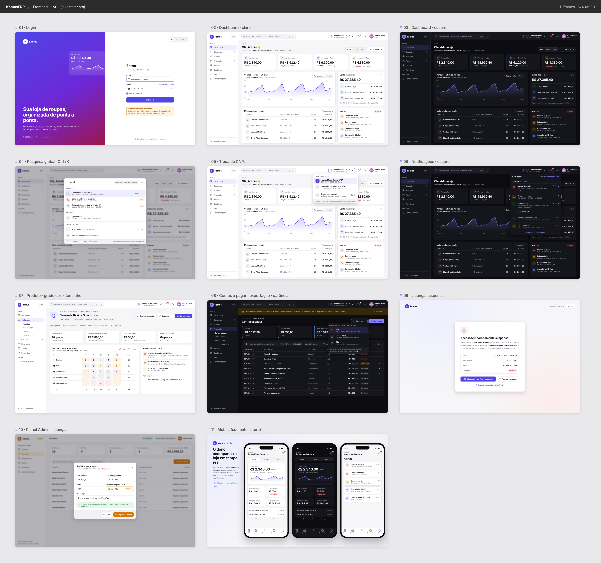

# Mockups do frontend (v0.1)

Telas conceituais geradas a partir dos requisitos do [LEVANTAMENTO.md](../../LEVANTAMENTO.md). Servem de referência visual, não de especificação final.



| # | Tela | O que demonstra |
|---|---|---|
| 01 | [Login](01-login.png) | Login com usuário de teste do seed (só em Development), seletor de tema |
| 02 | [Dashboard · claro](02-dashboard-claro.png) | Shell (sidebar + topbar), KPIs, gráfico, saldos, mais vendidos, alertas |
| 03 | [Dashboard · escuro](03-dashboard-escuro.png) | Mesmo layout no dark mode (tokens de cor) |
| 04 | [Pesquisa global](04-pesquisa-global.png) | Command palette (Ctrl+K): produtos, SKU/EAN, clientes, telas |
| 05 | [Troca de CNPJ](05-seletor-empresa.png) | Dropdown de empresas + visão consolidada (somente leitura) |
| 06 | [Notificações](06-notificacoes-escuro.png) | Sininho com não lidas, relatório pronto para baixar |
| 07 | [Produto com grade](07-produto-grade.png) | Matriz cor × tamanho, quebra de grade, etiquetas |
| 08 | [Contas a pagar](08-contas-pagar-exportar.png) | Exportação PDF/Excel/CSV com filtros + banner de carência da licença |
| 09 | [Licença suspensa](09-licenca-suspensa.png) | Tela de bloqueio com dados preservados |
| 10 | [Painel Admin](10-admin-licencas.png) | Gestão de licenças e registro de pagamento (libera na hora) |
| 11 | [Mobile](11-mobile.png) | App do dono, somente leitura, claro/escuro, alertas |

## Como regenerar

As telas são HTML/CSS em [`src/mockups.html`](src/mockups.html) (usando os mesmos tokens de cor previstos para o frontend real) e viram PNG com Playwright:

```bash
node docs/mockups/src/render.mjs
```
